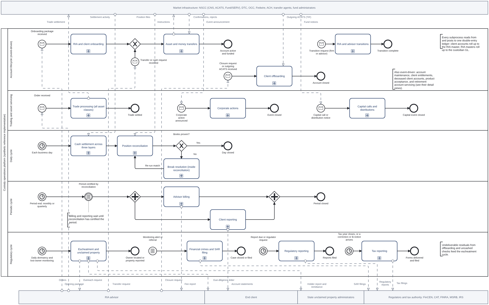
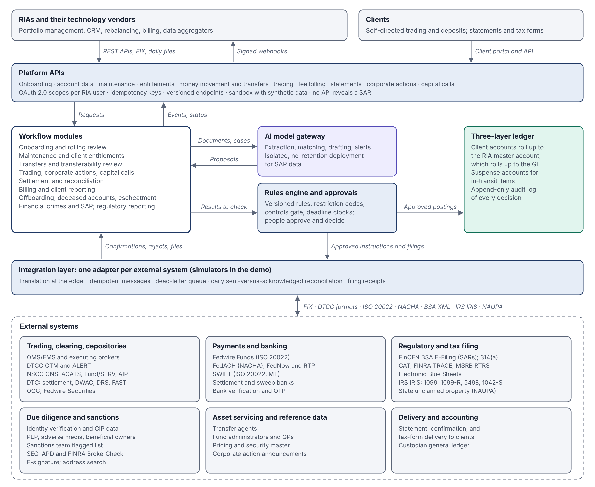

# RIA Custody Operations Platform: Process Architecture

**Live viewer:** https://shawngggg.github.io/AI-embedded-RIA-custody-operations-platform/

**Live MVP:** https://ria-custody-1638463558.us-central1.run.app/ (synthetic data; sign in as any demo role, no password. The first visit after a quiet spell takes a few seconds while the app and database wake up.)

**Product requirements:** [PRD.md](PRD.md), covering users, the MVP, architecture, releases, and success metrics

A BPMN 2.0 process architecture for an AI-embedded RIA custody operations platform: 25 detailed processes covering the full account lifecycle, from RIA firm onboarding and product acceptance through trading, settlement, billing, reporting, retirement servicing, transitions, offboarding, escheatment, and regulatory filings.

**Phase one**, mapping every process, is complete. **Phase two**, building the platform module by module, is under way: the onboarding module is built, the MVP web app puts it in front of a custody operations team, the RIAs, and their clients, and release 2's core adds the books: a three-layer ledger, asset and money transfers, cash settlement, and position reconciliation.



## Integration architecture

Every request enters through the platform APIs, every outbound instruction or filing passes the rules engine and a person's approval before the integration layer sends it, and AI reaches models only through its own gateway. The integration layer has one adapter per external system: clearing and depositories (NSCC, DTC, OCC, DTCC CTM), payment rails (Fedwire, FedACH, FedNow, RTP, SWIFT), regulators and tax (FinCEN BSA E-Filing, CAT, TRACE, MSRB RTRS, Electronic Blue Sheets, IRS IRIS, state unclaimed property), due diligence services, transfer agents and fund administrators, and advisor technology. The demo runs simulators that use the public message formats.



## Design principles

- **AI proposes; rules and people decide; the ledger records.** AI handles unstructured inputs and exceptions, such as document extraction, NIGO categorization, address matching, and break triage. Every decision passes a deterministic rules check or a human approval, and nothing AI produces posts to the ledger directly.
- **One three-layer ledger.** Client accounts roll up to the RIA master account, and RIA masters roll up to the custodian general ledger.
- **First line and second line stay separate.** Operations escalates; compliance and the sanctions team decide. Restriction codes can be removed only by the function that owns them.
- **The RIA is the channel and makes the investment decisions.** On pure RIA accounts, account changes, money movement, and asset transfers come through the RIA, which owns account entitlements and client and product suitability; owner-level changes, such as beneficiaries and registration, carry the client's signature. On the self-directed account, the client makes the changes. The custodian provides the platform and holds the assets. It makes no investment judgment and decides only what its own obligations require: options and margin approval, AML and sanctions, fraud holds, legal process, and which assets it will hold.
- **Two account groups, no dual management.** A client has one or more pure RIA accounts managed by the RIA, and may have one designated self-directed account as an added benefit. The client trades and deposits there freely. An RIA grant turns on self-service outgoing money movement and transfers, and the client can always move assets out through a signed request or a receiving firm's ACATS transfer. The RIA has view-only access and decides whether to bill it, and keeping client-directed trading in its own account keeps the RIA's fiduciary scope unambiguous.
- **Validated where experienced, researched where not.** Steps I performed are validated against my experience. Steps I didn't perform are built from current US regulation and industry practice and labeled as reference design, and my own positions were checked against the rules.
- **Shared subprocesses instead of repeated steps.** Sanctions escalation and the transferability review are modeled once and called from onboarding, maintenance, transfers, and offboarding.
- **Built to connect.** The design assumes adapters for clearing (NSCC, DTC, OCC), payment rails, KYC and screening services, regulators, transfer agents, and AI model providers.

## Process inventory and review status

Each process is labeled by how far it has been validated:

| Process | Status |
|---|---|
| Platform overview | Overview |
| Integration architecture | Overview |
| RIA firm onboarding | Validated |
| Client account opening (paths A and B) | Validated |
| Product acceptance | Partially validated |
| Rolling review | Validated |
| Account maintenance | Validated |
| Client entitlement management | Proposed enhancement |
| Retirement account servicing | Partially validated |
| Sanctions escalation (shared) | Validated |
| Transferability review (shared) | Validated |
| Asset and money transfers | Partially validated |
| Trade processing | Partially validated |
| Corporate actions | Partially validated |
| Capital calls and distributions | In review |
| Cash settlement | Validated |
| Position reconciliation | Partially validated |
| Advisor billing | Validated |
| Client reporting | Validated |
| Client offboarding | Validated |
| Deceased client account | Partially validated |
| RIA firm transitions (joining or leaving with a book) | Partially validated |
| Advisor moves and RIA mergers | In review |
| Escheatment | Validated |
| Financial crimes and SAR filing | Partially validated |
| Regulatory reporting | Partially validated |
| Tax reporting | Partially validated |

- **Validated:** corrected against my operating experience.
- **Partially validated:** key steps validated; the rest is reference design built from regulation and industry practice.
- **In review:** reference design built from regulation and industry practice, awaiting validation.
- **Proposed enhancement:** a platform capability beyond standard practice.

Every process is now mapped: 11 are validated, 11 partially validated, 2 in review, and 1 is a proposed enhancement.

## Onboarding module

`onboarding/` holds the first platform module: RIA firm onboarding and client account opening, built along process maps 01 and 02. **[Try the onboarding console](https://shawngggg.github.io/AI-embedded-RIA-custody-operations-platform/console/)**: it runs the same Python code in your browser, stops where a map waits for a person, and lets you make that person's decision.

| Milestone | What it does | Code |
|---|---|---|
| 1. Data model and path decision | Account groups, Path A or B, reliance eligibility, the account-opening gate | `models.py` |
| 2. Firm and account rules | Registration and licensing, KYB, CIP, and CDD as effective-dated rules, each with a citation | `rules.py`, `firm_rules.py`, `account_rules.py` |
| 3. Restriction codes | Only the owning function can remove a code; removals that need a decision need an authorization reference; every attempt is logged | `restrictions.py` |
| 4. First-line flagged-list check | Name and identifier matching, sanctioned jurisdictions, OFAC's 50 Percent Rule, escalation to the sanctions team | `flagged_list.py` |
| 5. Risk rating and EDD | Cited risk factors, FATF lists by date, EDD requirements, review cadence | `risk.py` |
| 6. Transferability | ACATS in kind, letter of instruction, liquidation, or product acceptance for each position; full or partial release | `transferability.py` |
| 7. AI extraction | Claude structured outputs behind a deterministic controls gate: every value must be quoted from the documents | `extraction.py` |
| 8. Demo console | The module running in the browser through Pyodide | `docs/console/` |
| Account changes | Map 04: channel check by account group, client signature for owner-level changes, medallion for re-registration, fraud-pattern lookback, screening of new parties and banks, due diligence re-run | `account_changes.py` |
| Rolling review | Review dates by risk tier, early review on an ownership change, a refresh request with a 30-day response window, and a KYCR code when it's missed | `rolling_review.py` |

`pipeline.py` runs the milestones in map order and returns a step-by-step trace, every rule finding with its source, the restriction codes placed, and an audit record.

The rules are dated, so the same application can get a different answer on a different date. The code tracks these changes:

- FinCEN's exceptive relief of Feb. 13, 2026: an entity's beneficial owners are identified at its first account, not at every new one.
- The SEC staff relief that lets a custodian rely on an RIA for CIP runs through Jan. 1, 2028; after that, accounts fall back to Path B unless the relief is extended.
- FATF's lists of June 19, 2026 drive the jurisdiction risk factors.
- The Syria sanctions program ended July 1, 2025.

To run it from the repo root:

```
pip install -r requirements.txt
python -m pytest onboarding -v      # 257 tests
python onboarding/demo.py           # every scenario, printed step by step
```

## Release 2 engine: the books

`custody/` holds release 2's engine, built along maps 05, 08, 12, 13, 16, 17, 22, 23, and 24. Like the onboarding module, it's pure Python with no database: each workflow is a function of the request, the decisions people approved, and the events recorded on the case (a rail's answer, a callback, a fix), and it returns the steps, the status, and the ledger postings the case should have made. The app replays it on every change and posts only what's missing.

| Module | What it does | Code |
|---|---|---|
| Three-layer ledger | The chart of accounts, balanced legs at the client, RIA master, and general ledger layers, and the rollup check every posting must pass | `ledger.py` |
| Asset and money transfers | ACH, wires, journals, IRA distributions, ACATS in and out, and LOI re-registration: authority, restriction codes, cash, the flagged list, risk signals, transferability, the controls gate, and simulated rails | `money.py` |
| Cash settlement | Matching unapplied incoming cash to accounts, and netting the day's funding by channel | `settlement.py` |
| Position reconciliation | Books against the street, break patterns, routing by type and value, escalation by age and value, certification | `recon.py` |
| Policy | Every threshold as a versioned, dated rule with its source; "platform policy" marks this design's own choices | `policy.py` |
| Entitlements, products, lifecycle | Client grants, product acceptance, offboarding, deceased accounts, RIA transitions, advisor moves and mergers (built and tested; in the app next) | `entitlements.py`, `products.py`, `lifecycle.py` |

```
python -m pytest custody -q          # 32 tests
```

## MVP web app

`app/` and `web/` hold the MVP from the [PRD](PRD.md): a working web app built on the onboarding module, for the custody operations team (the workbench) and for RIAs and their clients (the portal). It uses synthetic data, and the demo signs you in by role, no password needed. Each internal person sees only the pages their role and team use, and the API refuses (and logs) the rest. Transfers and money movement, cash settlement, and reconciliation are built on the release 2 ledger (below). Trading and fee billing appear as planned pages marked release 3, shown in the workbench only to the team that will run each (trade, billing), the operations supervisor, and, for trading, the RIA service team.

**Release 2: the books.** Every open account has a ledger at three layers: the client account, its RIA's master account, and the custodian's general ledger. Each posting is checked before it's written, and one that would break the rollup is refused. Transfers and money movement are cases: the RIA asks in the portal for its pure RIA accounts, a client deposits to the self-directed account, and the asset transfer team enters a client-signed request or a receiving firm's ACATS. Each request runs authority, restriction codes, cash, the flagged list, risk signals, and the transferability review, then the controls gate. The RIA pays a third party only under the client's standing letter of authorization (SLOA): the client signs it, client service verifies it under maker-checker, the payee comes from the SLOA exactly as the client named it, and the client gets a written confirmation, a notice after each payment, and a yearly reconfirmation. Fraud monitoring sends a first large wire to a destination not on file, an ACH withdrawal to a newly verified bank link, a burst of requests, or an account being drained to a risk review. Then the controls gate: a maker and a different checker release outgoing money, an analyst up to $50,000 and the supervisor above it, with a callback over $100,000 or on a signed request to a number on file (the form offers only those numbers, and the server refuses any other). The rails are simulated and answer on their real timing (ACATS within 1 business day to validate and 3 to complete), on the Federal Reserve calendar for ACH and wires and NSCC's for ACATS. A wire released after 5:00 pm ET, an ACH after 3:00 pm ET, or anything released on a closed day goes out the next business day. The settlement team runs the daily cycle (rail answers, ACH holds, unapplied cash, the three-layer check, net funding) and reconciles the books against DTC, the transfer agents, the sponsors, and the bank, with known breaks fixed automatically, the rest drafted or investigated, and the day certified when nothing but in-transit items is open. The seed opens each account's balance or incoming ACATS and then runs 18 more transfer scenarios: a wire waiting for a callback, one for release, a trust's tuition payment under its SLOA, one in risk review, one held for a flagged bank, a blocked withdrawal, ACH returns, a rejected and an overdue ACATS, and others, plus unapplied receipts and five reconciliation breaks. The portal sees its requests in its own words and balances at the client layer only, never the master, the general ledger, a risk review, or a sanctions hold.

**Release 3 previews.** Trading and billing open with a read-only preview built on the ledger's positions: a two-day blotter (block orders allocated at one average price, Fund/SERV orders, self-directed orders), open fails with Reg SHO close-out dates, and a quarter's fee runs tiered by household, one waiting for the RIA's approval. A DOCS account trades nothing and can't be debited for fees. The seed also holds 63 onboarding, CIP, and account-change cases across every queue. `python -m synthetic.export` writes all of it, the ledger's postings included, to CSV and JSON in [`synthetic/data/`](synthetic/data/README.md).

What each role can do:

- **Operations analyst:** start from the Work page (what needs you, unread messages, open risk events, restricted accounts), work your team's queues with SLA clocks, check each document that arrives and record the item it satisfies, and confirm suspicious account changes. Operations is split into teams (onboarding, CIP, client service, and so on); only the onboarding team takes in new applications, by form or by having AI read the package, and the submitted case lands in its queue. A package read by AI waits in the AI review queue until each value the AI read is checked against the package and accepted, edited, or rejected (an edit or a rejection needs a reason): onboarding checks the firm and Form ADV facts, and CIP checks the identity facts (name, address, EIN, owners and control persons, formation and ownership documents). Only then do the rules run, on the values a person confirmed. Account maintenance sits with client service: account changes that need a confirmation or come back for items wait in client service's queues, and a change arriving by mail is entered there. The asset transfer team works Money movement: it enters requests that arrive by mail or from a receiving firm, records callbacks, applies fixes and corrections, and releases money under maker-checker (Marisol Vega makes, Hana Sato checks). The settlement team (Omar Haddad) runs the daily cycle, applies or returns unapplied cash, and resolves reconciliation breaks; trade and asset transfer can read that page. The trade and billing teams' workbenches arrive in release 3, so for now they see their team channel, restricted accounts, their area's risk events, case lookup, and the planned page for their function. Every team that works with accounts sees a case's decisions, sanctions determinations included; the platform administrator, whose job is access, and the portal don't.
- **Sanctions team, AML compliance, and supervisors:** decide escalated cases under maker-checker. One person proposes, a second person with the approving role approves, and the app refuses self-approval and logs the attempt. Every screening alert goes to compliance, never to operations: sanctions hits to the sanctions team; PEP and adverse-media alerts and high-risk cases to AML compliance. A PEP or adverse-media alert that the risk rating doesn't already send to EDD (a domestic PEP, say, or a new owner added by an account change) waits for AML compliance to clear it or require EDD. When an identity check fails, onboarding or CIP records why: insufficient information or the wrong type of document goes back to the RIA to resubmit, and new identity documents start verification again; a suspected fraudulent identity is held (IDFR) and goes to AML compliance, which confirms it (the case is declined and stays held) or clears it. Nothing about a fraud suspicion reaches the RIA or the client. On the sign-in page, **Start the clock** times a reviewer from a fresh application to an open account: the MVP gate's walkthrough measure, kept through demo resets and shown on the dashboard.
- **RIA service team (FINRA-licensed):** a registered principal accepts every new account and RIA relationship before it opens (FINRA Rule 4512). The acceptance panel lists every document operations found in good order, each with a direct link and a Reviewed tick, and Accept stays off until every one is ticked; the acceptance record lists the documents reviewed and which ones the principal opened. A document that needs another look goes back to operations with a reason (onboarding's rework queue, no notice to the RIA), and operations sends the case back when it's fixed. The custodian runs the trading platform, so it's a FINRA member broker-dealer. The app checks the person's registration, not just their role, and a principal can't accept a case they prepared. Operations needs no license.
- **RIA service team lead:** approves a principal's request to rescind an acceptance. The request restricts the account at once; an approved rescission un-opens it and sends the case back for review or rework. Every request is logged in the risk register (as a regulatory event when the issue found was regulatory) for the team to agree a remediation path: training, a technology change, or a procedure update.
- **Periodic review:** rolling reviews by risk tier. A missed refresh deadline places a KYCR code.
- **RIA user:** submit account applications (with each holder's phone and email, the trusted contact or the client's refusal, IRA type and beneficiaries, joint tenancy, and any FINRA or public-company affiliation), account changes, and transfers (ACH, wires, journals, incoming ACATS) for the firm's pure RIA accounts. Self-directed accounts are view-only for the RIA.
- **Client:** make changes and deposits on their own self-directed account. Moving money out needs the RIA's grant, which arrives with client entitlements; a client can always ask by signed request or have another firm start a transfer.

RIA users and clients sign in to a portal home page that welcomes them by name and firm, shows their relationship and service team, and lists what needs their attention. The portal shows none of the custodian's operations. Each request has a status in the portal's own words, the items needed, the documents sent, what was submitted, and a history. Every review state reads "In review", so a sanctions or EDD escalation is never disclosed. Engine steps, rule findings, the risk rating, due-diligence flags, restriction owners, staff names, and the audit trail stay inside, and the API refuses and logs any attempt to reach them.
- **Platform administrator:** add team members, assign roles, and record the RIA service team's FINRA registrations. A grant of a decision role or a registration change waits for a second administrator. The administrator runs users, roles, and rules, not cases, so queues and case files aren't in that menu. An RIA administrator manages its own firm's users.

An account whose KYC, CDD, EDD, CIP, and AML requirements are met opens even with non-regulatory items outstanding (the fee authorization or tax form), restricted from trading and fee deduction until they arrive. A missing client signature or LPOA holds the account: without the signature the custodian can't process the client's information, and without the LPOA the RIA can't act on the account. An item counts as received only when its document is attached, and every place someone reviews, accepts, or rejects links straight to the documents behind it, the Approvals list included. Each file keeps its SHA-256 fingerprint, and automated pre-checks read it for the client's name, tax ID, the right tax form, and a signature line; anything they can't confirm waits for a person. Every case replays through the engine from its stored application and approved decisions, so its result, restriction codes, and audit trail always match the current rules. Restriction codes come off only through their owning function. The operations dashboard reports the straight-through rate, the NIGO rate, queue depth, SLA breaches, time in each waiting state, and how often reviewers accept the AI's values unchanged, with the latest edits and rejections. The audit log is append-only and exports to JSON.

The risk register logs operational, regulatory, and financial events: the platform raises one on every rescission request, sanctions true match, case past its SLA, document reopened on an open account, and access and authentication event (an attempt to open another firm's case, repeated failed sign-ins, an administrator approving their own grant), and anyone can report one. Each event belongs to the area it pertains to, and each person sees only their own area's events plus any they reported: an onboarding analyst sees onboarding's, the platform administrator sees access and authentication. The owning team records the remediation and closes it. Team channels let internal staff discuss work chat-style, with `#16` linking a case, `ACC-2001` an account, and `@username` a person; a case's Discussion tab collects every message that references it. Every notice to an RIA or client (items requested, account opened, declined, change applied) goes through the email outbox, and with Microsoft 365 connected it sends through Microsoft Graph from a shared mailbox; demo mode holds it all.

**Stack:** FastAPI, SQLAlchemy, and Alembic on Python 3.13; React and TypeScript built with Vite; Postgres in production (Neon) and SQLite locally; Claude Haiku 5.5 for live extraction, signed-in users only, capped at 50 reads a day. Without an API key, AI intake runs the sample package with an illustrative, hand-written model response. Before any prompt or model change goes live, the platform administrator runs the AI evaluation (Users and rules): 20 synthetic firm packages with 19 seeded defects, traps and clean packages included, read by the live model and scored for NIGO detection recall and false NIGOs. Each package has an answer key, and the tests and the gate check confirm the set itself. Every value the AI reads in real use is stored with the model, the prompt version, and what the reviewer did; the share of live values accepted without an edit is the AI suggestion acceptance metric, reported by field and prompt version on the dashboard and the AI evaluation page. The illustrative sample is tracked apart and never counted, and reviewed values survive a demo reset.

To run it locally from the repo root:

```
pip install -r requirements.txt
cd web && npm ci && npm run build && cd ..
uvicorn app.main:app                 # http://localhost:8000, seeded on first start
python -m pytest app/tests -v        # 125 API, ledger and money movement, and synthetic book tests
python tools/gate_review.py          # MVP gate metrics from the PRD (CI runs it with --check)
```

For frontend work, run `npm run dev` in `web/` alongside `uvicorn app.main:app --reload`; Vite forwards `/api` to the app.

It runs live on Google Cloud Run with a Neon database, at no cost for a demo: https://ria-custody-1638463558.us-central1.run.app/. [docs/DEPLOY.md](docs/DEPLOY.md) has the deployment steps. GitHub Actions runs the onboarding and release 2 engine tests, the API tests on SQLite and Postgres, a migration check, and the frontend build on every push. Once CI passes on `main`, it deploys to Cloud Run (signing in with workload identity federation, no stored key) and smoke tests the live site.

## Repository contents

| Path | Contents |
|---|---|
| `PRD.md` | Product requirements document, with its diagrams in `docs/prd/` |
| `docs/index.html` | Interactive viewer (served by GitHub Pages) |
| `docs/diagrams/` | PNG image of every process |
| `bpmn/` | BPMN 2.0 XML files, editable in Camunda Modeler, bpmn.io, or Signavio |
| `onboarding/` | Onboarding module code and its tests |
| `custody/` | Release 2 engine: the ledger, transfers, settlement, reconciliation, entitlements, products, and the account lifecycle |
| `docs/console/` | Browser console for the onboarding module (with copies of the modules it loads) |
| `tools/sync_console.py` | Copies the modules into the console after a change |
| `app/` | Backend: API, data model, roles, queues, maker-checker, audit log, the ledger store, the settlement cycle, reconciliation, and its tests |
| `web/` | MVP screens (React and TypeScript): the operations workbench and the RIA and client portal |
| `synthetic/` | Synthetic data: the extra seeded cases, the book behind the release 3 previews, and the export of everything the demo seeds (`synthetic/data/`) |
| `migrations/` | Database migrations (Alembic) |
| `Dockerfile`, `docs/DEPLOY.md` | Container build and the Cloud Run and Neon deployment guide |
| `.github/workflows/ci.yml` | Continuous integration |

## Roadmap

1. Map every process (done) and validate the two maps still in review.
2. Build the onboarding module in Python, extending my [onboarding execution engine](https://github.com/shawngggg/onboarding-execution-engine) (policy-as-code KYC/AML rules), with a browser console (done).
3. Build the MVP web app for the custody operations team, RIAs, and clients (built and deployed).
4. Add the remaining modules: release 2's core (the ledger, transfers, settlement, reconciliation) is built; client entitlements, product acceptance, and the account lifecycle come next, then trading, billing, and reporting.

## Notes

- **Reference architecture.** Process content reflects my operating experience in RIA custody and brokerage operations, current US regulation, and industry practice. It does not depict any specific firm's internal procedures, systems, or data. All data and parties are synthetic.
- **How it was made.** The process content comes from my own review and corrections. The BPMN diagrams were produced with AI assistance (Claude). In the onboarding module, I wrote Milestone 1 (`onboarding/models.py`); its specification and tests were written with AI assistance. Milestones 2 to 8, account changes, and rolling review were written by Claude (Anthropic's AI model) to the requirements in my process maps. The MVP web app (`app/`, `web/`, `migrations/`) and the release 2 engine (`custody/`) were written by Claude to my PRD and process maps. The rule content is a reference design built from those maps and current regulation, not legal advice. The PRD was written with AI assistance (Claude) from my product decisions and review.
- **Third-party software.** The viewer embeds [bpmn-js](https://bpmn.io), licensed under the bpmn.io license; see `docs/BPMN-JS-LICENSE.txt`. Its watermark must remain visible. The onboarding console loads [Pyodide](https://pyodide.org) (Mozilla Public License 2.0) from jsDelivr.

## Author

**Shawn Ghodrati**, operations excellence, process improvement, and AI automation in banking, payments, and investment operations.
[LinkedIn](https://www.linkedin.com/in/shawngh) · [GitHub](https://github.com/shawngggg)
